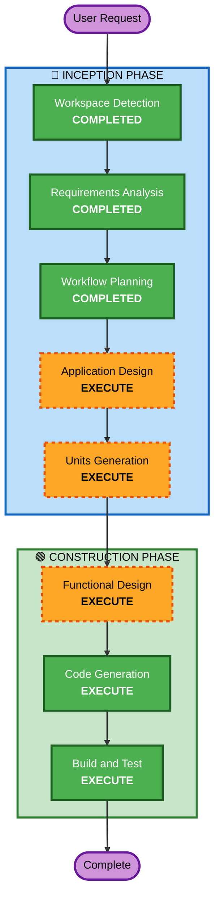

# Execution Plan — Kiro's Ghost Sokoban

## Detailed Analysis Summary

### Change Impact Assessment
- **User-facing changes**: Yes — entire new game application
- **Structural changes**: Yes — full application architecture from scratch
- **Data model changes**: Yes — level data structures, game state, persistence schema
- **API changes**: N/A — no backend
- **NFR impact**: Yes — 60fps rendering, Web Audio synthesis, responsive layout

### Risk Assessment
- **Risk Level**: Medium — complex multi-subsystem project but well-specified, no production dependencies
- **Rollback Complexity**: Easy — greenfield, no existing system to break
- **Testing Complexity**: Moderate — rendering and audio require manual verification, game logic is unit-testable

---

## Workflow Visualization



### Text Alternative
```
Phase 1: INCEPTION
  - Workspace Detection (COMPLETED)
  - Requirements Analysis (COMPLETED)
  - Workflow Planning (COMPLETED)
  - Application Design (EXECUTE)
  - Units Generation (EXECUTE)

Phase 2: CONSTRUCTION
  - Functional Design (EXECUTE) — per unit
  - Code Generation (EXECUTE) — per unit
  - Build and Test (EXECUTE)
```

---

## Phases to Execute

### 🔵 INCEPTION PHASE
- [x] Workspace Detection (COMPLETED)
- [x] Requirements Analysis (COMPLETED)
- [x] Workflow Planning (IN PROGRESS)
- [ ] Application Design — **EXECUTE**
  - **Rationale**: Complex multi-subsystem game needs component identification, service boundaries, and dependency mapping before code generation. 7+ modules (rendering, audio, core logic, UI, scenes, input, state) with significant interdependencies.
- [ ] Units Generation — **EXECUTE**
  - **Rationale**: Project decomposes naturally into multiple units of work (core engine, rendering, audio, UI, levels/data). Units enable structured code generation with clear boundaries.

### Skipped INCEPTION Stages
- Reverse Engineering — **SKIP** (Greenfield project)
- User Stories — **SKIP** (User did not request; spec is detailed enough)

### 🟢 CONSTRUCTION PHASE
- [ ] Functional Design — **EXECUTE** (per unit)
  - **Rationale**: Game logic (Sokoban rules, level parsing, state management) and rendering pipeline (wall occlusion, particle system, camera math) need detailed design before implementation.
- [ ] NFR Requirements — **SKIP**
  - **Rationale**: NFRs are already well-defined in requirements (60fps, pixel art textures, Web Audio, responsive layout). No additional assessment needed.
- [ ] NFR Design — **SKIP**
  - **Rationale**: NFR patterns are straightforward (requestAnimationFrame loop, NearestFilter textures, localStorage). No complex NFR design needed.
- [ ] Infrastructure Design — **SKIP**
  - **Rationale**: No infrastructure — purely client-side static files served from any web server.
- [ ] Code Generation — **EXECUTE** (per unit, always)
  - **Rationale**: Implementation of all game code.
- [ ] Build and Test — **EXECUTE** (always)
  - **Rationale**: Build verification and test instructions.

---

## Success Criteria
- **Primary Goal**: Fully playable Sokoban game in the browser with isometric 3D rendering and pixel art aesthetic
- **Key Deliverables**: All source files per project structure, 40 curated levels, chiptune audio, complete UI flow
- **Quality Gates**: Game loads and renders at 60fps, levels parse and play correctly, audio plays, state persists across sessions
